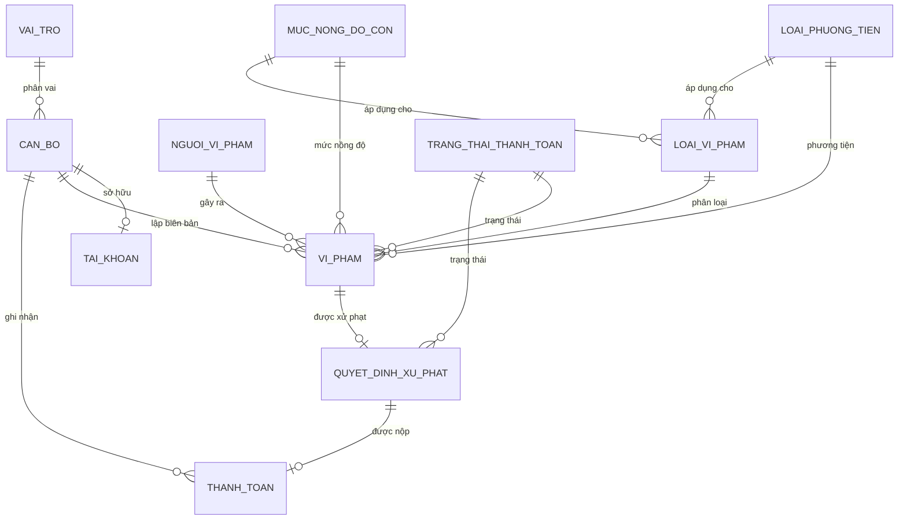

# Hướng dẫn cơ sở dữ liệu

Tài liệu này mô tả thiết kế CSDL của hệ thống **Quản lý xử phạt vi phạm nồng độ cồn**, cách cài đặt, kiểm tra, 
sao lưu và xử lý sự cố. Toàn bộ script nằm trong thư mục [`database/`](../database).

- [1. Môi trường và nguyên tắc thiết kế](#1-môi-trường-và-nguyên-tắc-thiết-kế)
- [2. Sơ đồ quan hệ](#2-sơ-đồ-quan-hệ)
- [3. Từ điển dữ liệu](#3-từ-điển-dữ-liệu)
- [4. Quy ước khóa và sinh mã](#4-quy-ước-khóa-và-sinh-mã)
- [5. Ràng buộc và chỉ mục](#5-ràng-buộc-và-chỉ-mục)
- [6. View, function, trigger và stored procedure](#6-view-function-trigger-và-stored-procedure)
- [7. Thứ tự cài đặt](#7-thứ-tự-cài-đặt)
- [8. Dữ liệu mẫu](#8-dữ-liệu-mẫu)
- [9. Kiểm tra nhanh sau khi cài](#9-kiểm-tra-nhanh-sau-khi-cài)
- [10. Sao lưu và phục hồi](#10-sao-lưu-và-phục-hồi)
- [11. Xử lý sự cố](#11-xử-lý-sự-cố)
- [12. Ghi chú thiết kế](#12-ghi-chú-thiết-kế)

---

## 1. Môi trường và nguyên tắc thiết kế

| Thành phần        | Giá trị |
|-------------------|---------|
| Hệ quản trị       | Microsoft SQL Server 2019+  |
| Tên CSDL          | `QuanLyXuPhatNongDoCon`     |
| Collation         | `Vietnamese_CI_AS`          |
| Kiểu xác thực     | Windows Authentication      |
| Recovery model    | `SIMPLE` (phù hợp môi trường học tập/kiểm thử) |

Nguyên tắc:

- Mô hình chuẩn hóa **3NF**, giữ nguyên tên bảng theo báo cáo: `VI_PHAM`, `MUC_NONG_DO_CON`, 
`LOAI_PHUONG_TIEN`, `LOAI_VI_PHAM`, `QUYET_DINH_XU_PHAT`, `TRANG_THAI_THANH_TOAN`, `CAN_BO`, 
`TAI_KHOAN`, `NGUOI_VI_PHAM`.
- Có thêm bảng `VAI_TRO` để chuẩn hóa phân quyền và bảng `TRANG_THAI_THANH_TOAN` theo mô hình báo cáo; 
không tạo bảng trùng chức năng.
- Mọi khóa ngoại đều được khai báo; xóa dữ liệu đang được tham chiếu sẽ bị chặn.
- Tiền phạt do **trigger** `TRIGGER_TINH_PHAT` lấy từ `LOAI_VI_PHAM.MucPhat`, không tính lại tùy ý ở tầng BLL.
- Trạng thái thanh toán được đồng bộ giữa `VI_PHAM` và `QUYET_DINH_XU_PHAT` bằng trigger và stored procedure.
- Sinh mã tự động bằng `SEQUENCE` + `DEFAULT` với tiền tố (`NVP`, `CB`, `TK`, `LPT`, `MND`, `LVP`, `VV`, `QD`, `BL`).

---

## 2. Sơ đồ quan hệ



Quan hệ chính:

| Quan hệ | Bản số | Ý nghĩa |
|---|---|---|
| `CAN_BO.VaiTro → VAI_TRO` | N:1 | Mỗi cán bộ có đúng một vai trò |
| `TAI_KHOAN.Ma_CanBo → CAN_BO` | 1:1 (unique) | Mỗi cán bộ tối đa một tài khoản |
| `VI_PHAM.Ma_NguoiViPham → NGUOI_VI_PHAM` | N:1 | Một người có thể có nhiều vụ vi phạm |
| `VI_PHAM.Ma_CanBo → CAN_BO` | N:1 | Cán bộ lập biên bản |
| `VI_PHAM` → `LOAI_VI_PHAM`, `LOAI_PHUONG_TIEN`, `MUC_NONG_DO_CON` | N:1 | Phân loại vụ việc |
| `QUYET_DINH_XU_PHAT.Ma_VuViec → VI_PHAM` | 1:1 (unique) | Mỗi vụ việc tối đa một quyết định |
| `THANH_TOAN.Ma_QuyetDinh → QUYET_DINH_XU_PHAT` | 1:1 (unique) | Mỗi quyết định tối đa một biên lai |
| `LOAI_VI_PHAM (Ma_LoaiPhuongTien, Ma_MucNongDoCon)` | unique | Cặp phương tiện – mức nồng độ chỉ có một loại vi phạm |

---

## 3. Từ điển dữ liệu

### 3.1 `VAI_TRO` — vai trò người dùng

| Cột | Kiểu | Ghi chú |
|---|---|---|
| `Ma_VaiTro` | `INT`, PK | 1 = Quản trị hệ thống, 2 = Cán bộ CSGT, 3 = Lãnh đạo, 4 = Cán bộ tài chính |
| `TenVaiTro` | `NVARCHAR(50)`, UNIQUE | Tên hiển thị |
| `MoTa` | `NVARCHAR(255)` | Mô tả quyền hạn |

### 3.2 `TRANG_THAI_THANH_TOAN` — trạng thái nộp phạt

| Cột | Kiểu | Ghi chú |
|---|---|---|
| `Ma_TrangThaiThanhToan` | `CHAR(10)`, PK | `TT01` Chưa nộp, `TT02` Đã nộp, `TT03` Quá hạn |
| `TenTrangThai` | `NVARCHAR(50)`, UNIQUE | Tên hiển thị |

### 3.3 `NGUOI_VI_PHAM` — người vi phạm

| Cột | Kiểu | Ràng buộc |
|---|---|---|
| `Ma_NguoiViPham` | `CHAR(10)`, PK | Mặc định `NVP` + sequence 7 số |
| `HoTen` | `NVARCHAR(100)` | Bắt buộc |
| `SoDienThoai` | `VARCHAR(15)` | Unique, bắt đầu bằng `0`, 10–11 số |
| `CanCuocCongDan` | `CHAR(12)` | Unique, đúng 12 số |
| `NgaySinh` | `DATE` | Cho phép NULL |
| `DiaChi` | `NVARCHAR(255)` | Bắt buộc |
| `GioiTinh` | `NVARCHAR(3)` | `Nam` hoặc `Nữ` |
| `SoGPLX` | `NVARCHAR(20)` | Unique có điều kiện, cho phép NULL |

### 3.4 `CAN_BO` — cán bộ

| Cột | Kiểu | Ràng buộc |
|---|---|---|
| `Ma_CanBo` | `CHAR(10)`, PK | `CB` + 8 số |
| `HoTen` | `NVARCHAR(100)` | Bắt buộc |
| `SoDienThoai` | `VARCHAR(15)` | Unique, 10–11 số, bắt đầu bằng `0` |
| `CanCuocCongDan` | `CHAR(12)` | Unique, đúng 12 số |
| `DiaChi` | `NVARCHAR(255)` | Bắt buộc |
| `CapBac` | `NVARCHAR(50)` | Bắt buộc |
| `DonViCongTac` | `NVARCHAR(100)` | Bắt buộc |
| `VaiTro` | `INT`, FK → `VAI_TRO` | Bắt buộc |

### 3.5 `TAI_KHOAN` — tài khoản đăng nhập

| Cột | Kiểu | Ràng buộc |
|---|---|---|
| `Ma_TaiKhoan` | `CHAR(10)`, PK | `TK` + 8 số |
| `TenDangNhap` | `NVARCHAR(50)` | Unique, 3–50 ký tự `A-Z a-z 0-9 . _ -` |
| `MatKhau` | `NVARCHAR(255)` | Chuỗi PBKDF2 (≥ 20 ký tự), không lưu mật khẩu thô |
| `Email` | `NVARCHAR(100)` | Unique, có `@` và dấu `.` |
| `Ma_CanBo` | `CHAR(10)`, FK, UNIQUE | Mỗi cán bộ một tài khoản |
| `TrangThai` | `BIT` | 1 = hoạt động, 0 = khóa |
| `NgayTao` | `DATETIME2(0)` | Mặc định thời điểm hiện tại |
| `LanDangNhapCuoi` | `DATETIME2(0)` | Cho phép NULL |

### 3.6 `LOAI_PHUONG_TIEN` — loại phương tiện

| Cột | Kiểu | Ghi chú |
|---|---|---|
| `Ma_LoaiPhuongTien` | `CHAR(10)`, PK | `LPT` + 7 số |
| `TenPhuongTien` | `NVARCHAR(100)` | Xe mô tô, ô tô con, xe tải, xe khách |
| `MoTa` | `NVARCHAR(255)` | Mặc định chuỗi rỗng |

### 3.7 `MUC_NONG_DO_CON` — mức nồng độ cồn

| Cột | Kiểu | Ghi chú |
|---|---|---|
| `Ma_MucNongDoCon` | `CHAR(10)`, PK | `MND` + 7 số |
| `KhoangGiaTri` | `NVARCHAR(50)` | Nhãn hiển thị, ví dụ `0.25 – 0.40 mg/L` |
| `MoTa` | `NVARCHAR(255)` | Mô tả |
| `NguongTren` | `DECIMAL(5,2)` | Ngưỡng trên; `NULL` = mức cao nhất |

Quy tắc phân mức (hàm `fn_PhanLoaiNongDo`):

- Mức 1: `0.00 – 0.25` (giá trị `<= 0.25` thuộc mức 1).
- Mức 2: `> 0.25 – 0.40`.
- Mức 3: `> 0.40`.

Hai filtered unique index đảm bảo chỉ một mức có `NguongTren = NULL` và các ngưỡng trên không trùng nhau.

### 3.8 `LOAI_VI_PHAM` — loại vi phạm và mức phạt

| Cột | Kiểu | Ràng buộc |
|---|---|---|
| `Ma_LoaiViPham` | `CHAR(10)`, PK | `LVP` + 7 số |
| `TenLoaiViPham` | `NVARCHAR(100)` | Bắt buộc |
| `MoTa` | `NVARCHAR(255)` | Cho phép NULL |
| `Ma_LoaiPhuongTien` | `CHAR(10)`, FK | Bắt buộc |
| `Ma_MucNongDoCon` | `CHAR(10)`, FK | Bắt buộc |
| `MucPhat` | `DECIMAL(18,2)` | `>= 0`; nguồn dữ liệu cho trigger tính phạt |

Ràng buộc `UQ_LVP_PT_MND` trên `(Ma_LoaiPhuongTien, Ma_MucNongDoCon)` bảo đảm không có hai loại vi phạm trùng cặp.

### 3.9 `VI_PHAM` — vụ việc vi phạm (biên bản)

| Cột | Kiểu | Ràng buộc |
|---|---|---|
| `Ma_VuViec` | `CHAR(10)`, PK | `VV` + 8 số |
| `ThoiGianViPham` | `DATETIME2(0)` | Bắt buộc |
| `DiaDiem` | `NVARCHAR(255)` | Bắt buộc |
| `NongDoCon` | `FLOAT` | `>= 0` (mg/L) |
| `BienSoXe` | `NVARCHAR(15)` | Tối thiểu 4 ký tự sau khi cắt khoảng trắng |
| `MoTaPhuongTien` | `NVARCHAR(255)` | Cho phép NULL; bổ sung theo yêu cầu 5.3 |
| `Ma_LoaiViPham` | `CHAR(10)`, FK | Bắt buộc |
| `Ma_LoaiPhuongTien` | `CHAR(10)`, FK | Phải khớp loại phương tiện của loại vi phạm (BLL kiểm tra) |
| `Ma_MucNongDoCon` | `CHAR(10)`, FK | Phải khớp phân loại nồng độ (BLL kiểm tra) |
| `Ma_CanBo` | `CHAR(10)`, FK | Cán bộ lập biên bản |
| `Ma_NguoiViPham` | `CHAR(10)`, FK | Người vi phạm |
| `Ma_TrangThaiThanhToan` | `CHAR(10)`, FK | Mặc định `TT01` |

### 3.10 `QUYET_DINH_XU_PHAT` — quyết định xử phạt

| Cột | Kiểu | Ràng buộc |
|---|---|---|
| `Ma_QuyetDinh` | `CHAR(10)`, PK | `QD` + 8 số |
| `Ma_VuViec` | `CHAR(10)`, FK, UNIQUE | Mỗi vụ việc một quyết định |
| `SoTienPhat` | `DECIMAL(18,2)` | `>= 0`; được trigger gán theo `LOAI_VI_PHAM.MucPhat` |
| `NgayRaQuyetDinh` | `DATE` | Không trước ngày vi phạm, không ở tương lai (BLL/SP kiểm tra) |
| `NgayNopPhat` | `DATE` | NULL nếu chưa nộp; `>= NgayRaQuyetDinh` |
| `Ma_TrangThaiThanhToan` | `CHAR(10)`, FK | Mặc định `TT01` |
| `NgayTao` | `DATETIME2(0)` | Mặc định thời điểm hiện tại |

### 3.11 `THANH_TOAN` — biên lai nộp phạt

| Cột | Kiểu | Ràng buộc |
|---|---|---|
| `Ma_ThanhToan` | `CHAR(10)`, PK | `BL` + 8 số |
| `Ma_QuyetDinh` | `CHAR(10)`, FK, UNIQUE | Một quyết định chỉ một biên lai |
| `NgayNop` | `DATETIME2(0)` | Không ở tương lai, không trước ngày ra quyết định |
| `SoTien` | `DECIMAL(18,2)` | `> 0` và phải bằng `SoTienPhat` (SP kiểm tra) |
| `PhuongThuc` | `NVARCHAR(30)` | `Tiền mặt` hoặc `Chuyển khoản` |
| `Ma_CanBo` | `CHAR(10)`, FK | Cán bộ thu tiền |
| `GhiChu` | `NVARCHAR(255)` | Cho phép NULL |
| `NgayTao` | `DATETIME2(0)` | Mặc định thời điểm hiện tại |

---

## 4. Quy ước khóa và sinh mã

- Khóa chính là chuỗi `CHAR(10)` có tiền tố nghiệp vụ, dễ đọc khi tra cứu và in ấn.
- Mã được sinh tự động bởi `SEQUENCE` ở cấp CSDL, không sinh trong C#. Nhờ vậy nhiều phiên làm việc đồng thời vẫn không trùng mã.
- Bảng `VAI_TRO` và `TRANG_THAI_THANH_TOAN` dùng mã cố định (`1..4`, `TT01..TT03`) vì là dữ liệu hệ thống.
- Sau khi nạp seed, các sequence được `RESTART` về đúng giá trị kế tiếp (xem mục 8) để bản demo có mã liên tục.

Ví dụ sinh mã:

```sql
INSERT INTO dbo.NGUOI_VI_PHAM (HoTen, SoDienThoai, CanCuocCongDan, DiaChi, GioiTinh)
VALUES (N'Nguyễn Văn Demo', '0909999999', '079200009999', N'Địa chỉ mẫu', N'Nam');

SELECT * FROM dbo.NGUOI_VI_PHAM WHERE SoDienThoai = '0909999999';
-- Ma_NguoiViPham = NVP0000031
```

---

## 5. Ràng buộc và chỉ mục

Script [`ConstraintsAndIndexes.sql`](../database/ConstraintsAndIndexes.sql) tạo:

**Khóa ngoại:** 14 FK bao phủ toàn bộ quan hệ ở mục 2 (gồm `CAN_BO.VaiTro`, `TAI_KHOAN.Ma_CanBo`, các FK của `VI_PHAM`, `QUYET_DINH_XU_PHAT`, `THANH_TOAN`, `LOAI_VI_PHAM`).

**Check constraint tiêu biểu:**

| Bảng | Ràng buộc | Nội dung |
|---|---|---|
| `NGUOI_VI_PHAM` 
| | `CK_NVP_CCCD` | 12 ký tự số |
| | `CK_NVP_SDT` | Bắt đầu bằng 0, 10–11 số |
| | `CK_NVP_GIOITINH` | `Nam`/`Nữ` |
| `CAN_BO` | `CK_CB_CCCD`, `CK_CB_SDT` | Như trên |
| `TAI_KHOAN` | `CK_TK_TENDANGNHAP` | 3–50 ký tự hợp lệ |
| | `CK_TK_EMAIL` | Có `@` và `.` |
| | `CK_TK_MATKHAU` | Độ dài ≥ 20 (hash PBKDF2) |
| `MUC_NONG_DO_CON` | `CK_MND_NGUONG` | `NguongTren > 0` nếu khác NULL |
| `LOAI_VI_PHAM` | `CK_LVP_MUCPHAT` | `MucPhat >= 0` |
| `VI_PHAM` | `CK_VV_NONGDO` | `NongDoCon >= 0` |
| | `CK_VV_BIENSO` | Biển số tối thiểu 4 ký tự |
| `QUYET_DINH_XU_PHAT` | `CK_QD_SOTIEN` | `SoTienPhat >= 0` |
| | `CK_QD_NGAYNOP` | `NgayNopPhat >= NgayRaQuyetDinh` |
| `THANH_TOAN` | `CK_TT_SOTIEN` | `SoTien > 0` |
| | `CK_TT_PHUONGTHUC` | `Tiền mặt`/`Chuyển khoản` |

**Unique:** tên vai trò, trạng thái, CCCD/SĐT người vi phạm và cán bộ, tên đăng nhập/email/tài khoản theo cán bộ, cặp phương tiện–mức nồng độ, `Ma_VuViec` của quyết định, `Ma_QuyetDinh` của thanh toán. Ngoài ra có filtered unique index cho `SoGPLX` và cho `NguongTren`.

**Index tìm kiếm:** họ tên người vi phạm; thời gian vi phạm (include trạng thái, nồng độ); biển số; các FK thường lọc; ngày ra quyết định; ngày nộp; trạng thái tài khoản.

---

## 6. View, function, trigger và stored procedure

### 6.1 View ([`Views.sql`](../database/Views.sql))

| View | Mục đích |
|---|---|
| `vw_ChiTietViPham` | Ghép vụ việc với người vi phạm, loại vi phạm, phương tiện, mức nồng độ, cán bộ, trạng thái và quyết định |
| `vw_QuyetDinhChiTiet` | Dữ liệu đầy đủ để hiển thị/in quyết định, kèm biên lai nếu có |
| `vw_ThanhToanChiTiet` | Biên lai kèm người vi phạm, biển số, quyết định, cán bộ thu |
| `vw_TaiKhoanDangNhap` | Tài khoản + cán bộ + vai trò phục vụ đăng nhập |
| `vw_ThongKeViPham` | Nguồn duy nhất cho dashboard và các báo cáo thống kê |

### 6.2 Function ([`Functions.sql`](../database/Functions.sql))

| Function | Mô tả |
|---|---|
| `fn_PhanLoaiNongDo(@NongDo FLOAT)` | Trả về `Ma_MucNongDoCon` theo quy tắc biên mục 3.7 |
| `fn_TinhMucPhat(@MaVuViec CHAR(10))` | Trả về `MucPhat` của loại vi phạm tương ứng |

### 6.3 Trigger ([`Triggers.sql`](../database/Triggers.sql))

**`TRIGGER_TINH_PHAT`** — trên `QUYET_DINH_XU_PHAT`, `AFTER INSERT, UPDATE`:

- Khi chèn/cập nhật quyết định, tự động đặt `SoTienPhat = LOAI_VI_PHAM.MucPhat` của vụ việc.
- Bỏ qua khi thao tác chỉ cập nhật trạng thái/ngày nộp (không đụng `SoTienPhat`/`Ma_VuViec`).
- Vì vậy tầng BLL **không** gửi tiền phạt tùy ý; dữ liệu tiền luôn nhất quán với danh mục.

**`TRIGGER_DONG_BO_TRANG_THAI_THANH_TOAN`** — trên `QUYET_DINH_XU_PHAT`:

- Khi quyết định đổi trạng thái, cập nhật `VI_PHAM.Ma_TrangThaiThanhToan` tương ứng.
- Chỉ cập nhật khi trạng thái thực sự thay đổi.

Kiểm thử trigger bằng transaction cuộn lại:

```sql
BEGIN TRANSACTION;

DECLARE @id CHAR(10);
EXEC dbo.sp_TaoQuyetDinh
     @MaVuViec = 'VV00000005',
     @NgayRaQuyetDinh = '2026-10-21',
     @MaTrangThai = 'TT01',
     @MaQuyetDinh = @id OUTPUT;

SELECT @id AS MaQuyetDinh, q.SoTienPhat, lv.MucPhat, v.NongDoCon
FROM dbo.QUYET_DINH_XU_PHAT q
JOIN dbo.VI_PHAM v ON v.Ma_VuViec = q.Ma_VuViec
JOIN dbo.LOAI_VI_PHAM lv ON lv.Ma_LoaiViPham = v.Ma_LoaiViPham
WHERE q.Ma_QuyetDinh = @id;

ROLLBACK TRANSACTION;
```

Kết quả mong đợi: `SoTienPhat` bằng đúng `MucPhat` dù giá trị chèn ban đầu là 0.

### 6.4 Stored procedure nghiệp vụ ([`StoredProcedures.sql`](../database/StoredProcedures.sql))

| Procedure | Chức năng | Kiểm tra chính |
|---|---|---|
| `sp_TaoQuyetDinh` | Tạo quyết định, trả mã qua `OUTPUT` | Vụ việc tồn tại, chưa có quyết định, ngày hợp lệ, trạng thái hợp lệ, không tạo mới ở `TT02` |
| `sp_CapNhatTrangThaiQuyetDinh` | Đổi trạng thái quyết định | Chỉ sang `TT02` khi đã có biên lai; không quay lại trạng thái chưa nộp khi đã có thanh toán |
| `sp_GhiNhanThanhToan` | Tạo biên lai + cập nhật trạng thái trong một transaction | Quyết định tồn tại, chưa thanh toán, số tiền khớp, ngày/phương thức hợp lệ, cán bộ tồn tại |

Cả ba procedure dùng `SET XACT_ABORT ON` và `TRY...CATCH` để rollback khi lỗi.

### 6.5 Stored procedure thống kê ([`Producers.sql`](../database/Producers.sql))

| Procedure | Đầu ra |
|---|---|
| `sp_ThongKeTongHop` | Tổng vụ việc, người vi phạm, số quyết định, chưa có quyết định, đã nộp/chưa nộp/quá hạn, tổng tiền phạt, tiền đã thu |
| `sp_ThongKeTheoThang` | Một dòng cho mỗi tháng trong khoảng, kể cả tháng không phát sinh |
| `sp_ThongKeTheoDiaDiem` | Nhóm theo địa điểm, sắp giảm dần theo số vụ |
| `sp_ThongKeTheoMucNongDo` | Nhóm theo khoảng nồng độ, sắp theo ngưỡng |
| `sp_ThongKeTheoCanBo` | Nhóm theo cán bộ lập biên bản |
| `sp_ThongKeTheoTrangThai` | Nhóm theo trạng thái thanh toán |

Tất cả nhận `@TuNgay`, `@DenNgay`; lọc theo **ngày vi phạm** (bao trùm cả ngày cuối) và đọc từ `vw_ThongKeViPham`, nên số liệu dashboard/báo cáo luôn khớp nhau.

---

## 7. Thứ tự cài đặt

Chạy đúng thứ tự sau (mỗi script đã có `USE [QuanLyXuPhatNongDoCon]`):

| Bước | Script | Nội dung |
|---|---|---|
| 1 | `CreateDatabase.sql` | **Xóa** CSDL cũ nếu tồn tại, tạo mới với collation Việt Nam |
| 2 | `Tables.sql` | Sequence + 11 bảng |
| 3 | `ConstraintsAndIndexes.sql` | FK, check, unique, index |
| 4 | `Functions.sql` | Hai hàm phân loại/tính phạt |
| 5 | `Views.sql` | Năm view |
| 6 | `Triggers.sql` | Hai trigger |
| 7 | `StoredProcedures.sql` | Ba procedure nghiệp vụ |
| 8 | `Producers.sql` | Sáu procedure thống kê |
| 9 | `SeedData.sql` | Dữ liệu mẫu + kiểm tra nhất quán |

### Cách 1: SQL Server Management Studio

Mở lần lượt từng file, kết nối `localhost\SQLEXPRESS01` bằng Windows Authentication, bấm **Execute**. Khi chạy `CreateDatabase.sql`, đảm bảo không có ứng dụng nào đang kết nối CSDL cũ.

### Cách 2: `sqlcmd` (khuyến nghị)

Từ thư mục gốc project:

```bat
sqlcmd -S "localhost\SQLEXPRESS01" -E -b -f 65001 -i database\CreateDatabase.sql
sqlcmd -S "localhost\SQLEXPRESS01" -E -b -f 65001 -i database\Tables.sql
sqlcmd -S "localhost\SQLEXPRESS01" -E -b -f 65001 -i database\ConstraintsAndIndexes.sql
sqlcmd -S "localhost\SQLEXPRESS01" -E -b -f 65001 -i database\Functions.sql
sqlcmd -S "localhost\SQLEXPRESS01" -E -b -f 65001 -i database\Views.sql
sqlcmd -S "localhost\SQLEXPRESS01" -E -b -f 65001 -i database\Triggers.sql
sqlcmd -S "localhost\SQLEXPRESS01" -E -b -f 65001 -i database\StoredProcedures.sql
sqlcmd -S "localhost\SQLEXPRESS01" -E -b -f 65001 -i database\Producers.sql
sqlcmd -S "localhost\SQLEXPRESS01" -E -b -f 65001 -i database\SeedData.sql
```

- `-E`: Windows Authentication.
- `-b`: trả mã lỗi khác 0 khi script lỗi (tiện cho CI).
- `-f 65001`: đọc file theo UTF-8, tránh lỗi font tiếng Việt.

Nếu dùng tài khoản SQL:

```bat
sqlcmd -S "localhost\SQLEXPRESS01" -U sa -P "<mật-khẩu>" -b -f 65001 -i database\Tables.sql
```

Không ghi mật khẩu thật vào script hay mã nguồn. Ứng dụng dùng Windows Authentication qua `appsettings.json`.

---

## 8. Dữ liệu mẫu

`SeedData.sql` nạp dữ liệu **hư cấu** (không dùng thông tin cá nhân thật):

| Bảng | Số dòng | Ghi chú |
|---|---:|---|
| `VAI_TRO` | 4 | Quản trị, CSGT, Lãnh đạo, Tài chính |
| `TRANG_THAI_THANH_TOAN` | 3 | TT01, TT02, TT03 |
| `LOAI_PHUONG_TIEN` | 4 | Mô tô, ô tô con, xe tải, xe khách |
| `MUC_NONG_DO_CON` | 3 | Mức 1, 2, 3 |
| `LOAI_VI_PHAM` | 12 | 4 phương tiện × 3 mức, mức phạt mẫu |
| `CAN_BO` | 6 | Đủ 4 vai trò |
| `TAI_KHOAN` | 6 | 5 hoạt động, 1 bị khóa |
| `NGUOI_VI_PHAM` | 30 | CCCD/SĐT/giấy phép lái xe hư cấu |
| `VI_PHAM` | 60 | Phân bố từ 15 đến 174 ngày trước thời điểm seed (khoảng 6 tháng) |
| `QUYET_DINH_XU_PHAT` | 48 | Cứ mỗi 5 vụ thì 1 vụ chưa có quyết định |
| `THANH_TOAN` | 21 | Một phần quyết định đã nộp |

Tài khoản demo:

| Tên đăng nhập | Mật khẩu | Vai trò | Trạng thái |
|---|---|---|---|
| `admin` | `Admin@123` | Quản trị hệ thống | Hoạt động |
| `csgt01` | `Csgt@123` | Cán bộ CSGT | Hoạt động |
| `csgt02` | `Csgt@123` | Cán bộ CSGT | Hoạt động |
| `lanhdao` | `Lanhdao@123` | Lãnh đạo | Hoạt động |
| `taichinh` | `Taichinh@123` | Cán bộ tài chính | Hoạt động |
| `csgt03` | `Csgt@123` | Cán bộ CSGT | **Bị khóa** (kiểm thử) |

Mật khẩu trong CSDL được lưu dưới dạng PBKDF2-SHA256 (`iterations.salt.hash`). Seed không chứa mật khẩu thô.

Sau khi nạp, các sequence được đặt lại: người vi phạm 31, cán bộ 7, tài khoản 7, loại phương tiện 5, mức nồng độ 4, loại vi phạm 13, vụ việc 61, quyết định 49, thanh toán 22. Nhờ đó bản ghi mới có mã kế tiếp liền mạch.

> `SeedData.sql` sẽ `THROW` nếu bảng `NGUOI_VI_PHAM` đã có dữ liệu. Muốn nạp lại, chạy `CreateDatabase.sql` rồi chạy lại toàn bộ chuỗi script.

---

## 9. Kiểm tra nhanh sau khi cài

```sql
USE QuanLyXuPhatNongDoCon;
GO

-- 1) Số lượng bản ghi chính
SELECT N'NGUOI_VI_PHAM' AS Bang, COUNT(*) AS SoLuong FROM dbo.NGUOI_VI_PHAM
UNION ALL SELECT N'VI_PHAM', COUNT(*) FROM dbo.VI_PHAM
UNION ALL SELECT N'QUYET_DINH_XU_PHAT', COUNT(*) FROM dbo.QUYET_DINH_XU_PHAT
UNION ALL SELECT N'THANH_TOAN', COUNT(*) FROM dbo.THANH_TOAN;

-- 2) Tiền phạt phải bằng mức phạt danh mục (kỳ vọng 0 dòng)
SELECT q.Ma_QuyetDinh, q.SoTienPhat, lv.MucPhat
FROM dbo.QUYET_DINH_XU_PHAT q
JOIN dbo.VI_PHAM v ON v.Ma_VuViec = q.Ma_VuViec
JOIN dbo.LOAI_VI_PHAM lv ON lv.Ma_LoaiViPham = v.Ma_LoaiViPham
WHERE q.SoTienPhat <> lv.MucPhat;

-- 3) Trạng thái vụ việc và quyết định phải đồng bộ (kỳ vọng 0 dòng)
SELECT q.Ma_QuyetDinh
FROM dbo.QUYET_DINH_XU_PHAT q
JOIN dbo.VI_PHAM v ON v.Ma_VuViec = q.Ma_VuViec
WHERE q.Ma_TrangThaiThanhToan <> v.Ma_TrangThaiThanhToan;

-- 4) Thống kê tổng hợp 10 tháng
EXEC dbo.sp_ThongKeTongHop @TuNgay = '2026-01-01', @DenNgay = '2026-10-31';

-- 5) Kiểm tra trigger (chạy trong transaction và rollback)
BEGIN TRANSACTION;
DECLARE @id CHAR(10);
EXEC dbo.sp_TaoQuyetDinh 'VV00000005', '2026-10-21', 'TT01', @id OUTPUT;
SELECT @id AS MaQuyetDinh, SoTienPhat FROM dbo.QUYET_DINH_XU_PHAT WHERE Ma_QuyetDinh = @id;
ROLLBACK TRANSACTION;
```

Kỳ vọng: bước 1 trả `30 / 60 / 48 / 21`; bước 2–3 không có dòng nào; bước 5 hiển thị tiền phạt khác 0 dù ban đầu chèn 0.

---

## 10. Sao lưu và phục hồi

CSDL đang ở `RECOVERY SIMPLE`, phù hợp môi trường demo. Nên sao lưu trước khi thao tác thử nghiệm.

### Sao lưu

```sql
BACKUP DATABASE [QuanLyXuPhatNongDoCon]
TO DISK = N'C:\Backup\QuanLyXuPhatNongDoCon.bak'
WITH INIT, COMPRESSION, STATS = 10;
```

Thư mục `C:\Backup` phải tồn tại và tài khoản chạy SQL Server phải có quyền ghi. Có thể dùng SSMS: chuột phải CSDL → **Tasks → Back Up...**.

### Phục hồi

```sql
-- Đóng kết nối đang mở
ALTER DATABASE [QuanLyXuPhatNongDoCon] SET SINGLE_USER WITH ROLLBACK IMMEDIATE;

RESTORE DATABASE [QuanLyXuPhatNongDoCon]
FROM DISK = N'C:\Backup\QuanLyXuPhatNongDoCon.bak'
WITH REPLACE, RECOVERY;

ALTER DATABASE [QuanLyXuPhatNongDoCon] SET MULTI_USER;
```

Sau khi phục hồi, mở lại ứng dụng; dữ liệu dashboard sẽ phản ánh đúng bản sao lưu.

### Khôi phục môi trường sạch

Chạy lại `CreateDatabase.sql` rồi toàn bộ chuỗi script ở mục 7. **Thao tác này xóa toàn bộ dữ liệu hiện có**, chỉ thực hiện khi chắc chắn không cần dữ liệu cũ.

---

## 11. Xử lý sự cố

| Hiện tượng | Nguyên nhân thường gặp | Cách xử lý |
|---|---|---|
| `Login failed for user` | Chưa bật Windows Authentication hoặc dùng sai tài khoản | Dùng `-E` với `sqlcmd`; kiểm tra instance `localhost\SQLEXPRESS01` đang chạy |
| `Cannot open database "QuanLyXuPhatNongDoCon"` | Chưa chạy `CreateDatabase.sql` hoặc sai tên CSDL | Chạy lại bước 1–9; kiểm tra `ConnectionStrings:Default` |
| Tiếng Việt bị lỗi font khi chạy script | File đọc sai bảng mã | Luôn thêm `-f 65001` cho `sqlcmd`; lưu file dạng UTF-8 |
| `There is already an object named ...` | Chạy lại script tạo bảng trên CSDL cũ | Chạy `CreateDatabase.sql` để tạo sạch, rồi chạy lại chuỗi |
| `Dữ liệu đã tồn tại...` từ seed | Đã seed trước đó | Chạy lại `CreateDatabase.sql` rồi seed lại |
| Tiền phạt trên quyết định sai | Trigger bị tắt hoặc danh mục bị sửa sau khi tạo quyết định | Kiểm tra `sys.triggers`; bật trigger; đối chiếu `LOAI_VI_PHAM.MucPhat` |
| Trạng thái vụ việc lệch quyết định | Trigger đồng bộ bị tắt hoặc dữ liệu chỉnh tay | Bật `TRIGGER_DONG_BO_TRANG_THAI_THANH_TOAN`; chạy truy vấn kiểm tra mục 9 |
| `The DELETE statement conflicted with the REFERENCE constraint` | Xóa bản ghi đang được tham chiếu | Không xóa cứng dữ liệu lịch sử; dùng nghiệp vụ thay thế |
| Không drop được CSDL | Còn kết nối đang mở | Đóng ứng dụng/SSMS; `CreateDatabase.sql` đã dùng `SINGLE_USER WITH ROLLBACK IMMEDIATE` |
| `Conversion failed...` khi nhập ngày | Định dạng ngày phụ thuộc locale | Dùng định dạng ISO `yyyy-MM-dd` trong script; giao diện dùng `DateTimePicker` |
| Mã mới bị nhảy số | Sequence đã cấp số cho transaction bị rollback | Không ảnh hưởng toàn vẹn; có thể `ALTER SEQUENCE ... RESTART WITH <n>` khi cần bản demo đẹp |
| Kết nối báo lỗi chứng chỉ | SQL Server dùng chứng chỉ tự ký | Giữ `TrustServerCertificate=True` trong chuỗi kết nối mẫu |

Xem thêm log ứng dụng tại thư mục `Logs` cạnh file thực thi (xem `Skeleton.md`).

---

## 12. Ghi chú thiết kế

- **Không xóa cứng lịch sử vi phạm**: các bảng nghiệp vụ không có thao tác xóa dây chuyền; giao diện không cung cấp xóa người vi phạm/vụ vi phạm đã phát sinh quyết định.
- **Một biên lai cho một quyết định**: unique `Ma_QuyetDinh` trong `THANH_TOAN` ngăn thu trùng. Nghiệp vụ thu một lần đúng bằng số tiền phạt.
- **Dữ liệu thống kê lấy từ view**: mọi con số trên dashboard/báo cáo đều đọc từ CSDL qua stored procedure, không tính toán giả trong giao diện.
- **`MucPhat` là dữ liệu mẫu**, không phải mức phạt pháp lý hiện hành; khi triển khai thật cần cập nhật theo quy định và cấu hình đơn vị trong `appsettings.json`.
- **Thông tin tổ chức** trong cấu hình là placeholder theo yêu cầu, có thể sửa mà không ảnh hưởng mã nguồn.
- **Bảo mật**: tài khoản demo chỉ dùng cho học tập; mật khẩu PBKDF2; kết nối đọc từ cấu hình hoặc biến môi trường `ALCOHOL_DB_CONNECTION`, không hard-code trong mã.
